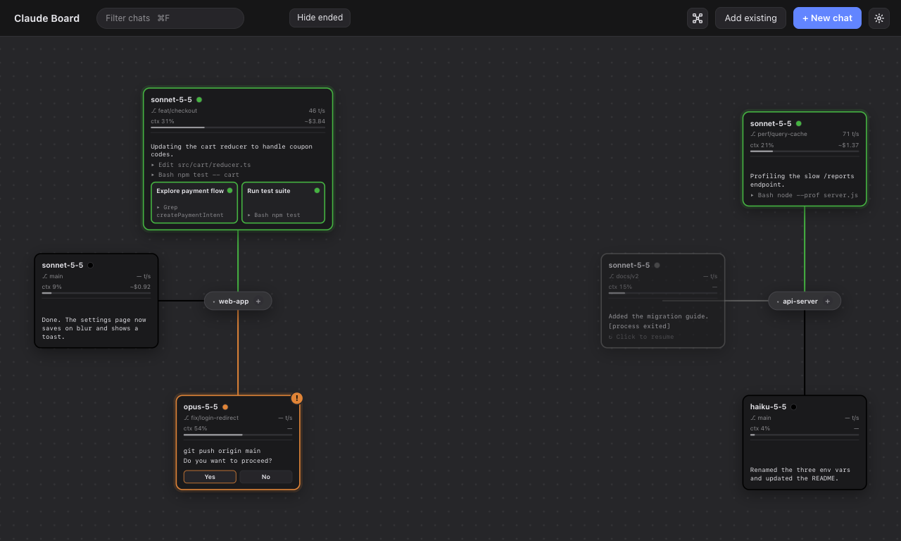
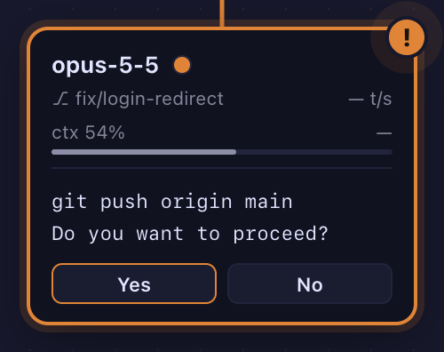
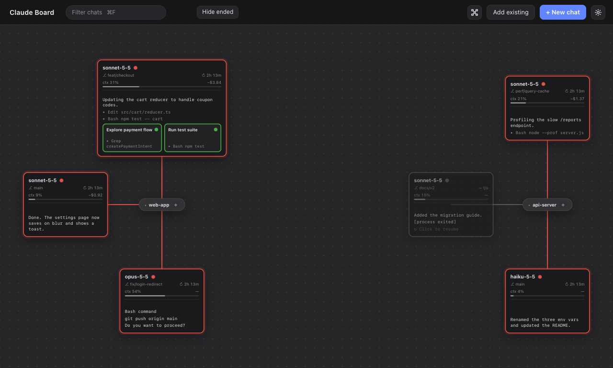
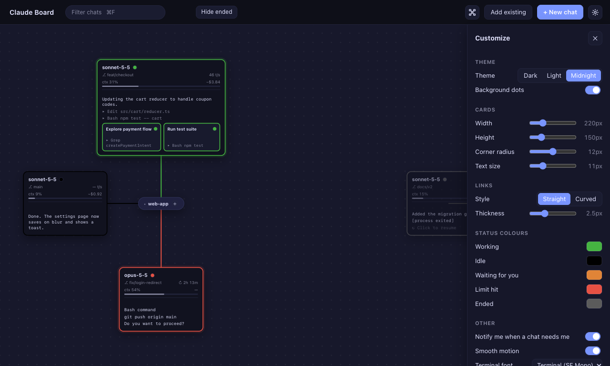

# Claude Board

**All your terminal Claude Code chats on one board.** Every chat is a real `claude` CLI running in a pseudo-terminal
(node-pty + xterm.js), so slash commands, permission prompts, colours, paste, resize and shortcuts behave exactly as they do in
Terminal.app. Nothing is re-implemented on top of the API.



Each project folder is a box in the middle, and its chats are cards around it. A card's outline tells you what the chat is doing
at a glance, so you can leave ten of them running and see which one needs you.

| | |
|---|---|
| **Green** | working |
| **Black** | idle, the turn is finished |
| **Orange** `!` | waiting for you: a permission prompt, question or trust dialog |
| **Red** | a usage limit was hit, with a countdown to when it lifts |
| **Grey** | ended, click to resume |

macOS only. The download is an Apple Silicon (arm64) build. On an Intel Mac, build from source (untested there).

## Install

**The quick way:** download `Claude-Board-1.0.0-arm64.zip` from the [latest release](https://github.com/erte-del/claude-board/releases/latest),
unzip it and drag **Claude Board** to `Applications`.

The app is ad-hoc signed, not notarized by Apple, so macOS blocks the first launch. Either right-click the app and choose **Open**,
then **Open** again, or run this once:

```sh
xattr -dr com.apple.quarantine "/Applications/Claude Board.app"
```

You also need [Claude Code](https://docs.claude.com/en/docs/claude-code) installed and signed in. The app finds `claude` through your
own shell (`~/.zshrc`), or in `~/.local/bin`, `/opt/homebrew/bin` or `/usr/local/bin`. If it can't, a banner at the top says so.

**From source:** see [Run from source](#run-from-source) below.

## Quick start

1. Press **⌘N**, type `cd ~/code/my-project` (or just a path) and press Enter. A card appears and Claude starts in that folder. **Browse folders…** is there if you'd rather pick one.
2. Click the card to open the chat full-window. **⌘⇧B** goes back to the board; the chat keeps running.
3. Start more chats, or press **+** on a folder's box to start another one in that folder.
4. Press **⌘O** to put a chat from your Claude Code history on the board as a resumable card.
5. Quit whenever you like: your chats come back as grey cards, and a click resumes them with `claude --resume`.

## What it does

### Know when a chat needs you, and answer it from the board



An orange card with a `!` is waiting on you. For a permission question ("Do you want to proceed?") it shows what is being asked
and **Yes** / **No** buttons, so you don't have to open the chat. You also get a macOS notification and a Dock badge (turn it off in
Customize).

### See usage limits coming and going



When a usage limit is hit, every chat turns red and shows when it lifts. The red clears by itself at that time.

### Make it yours



Three themes, every status colour, card size, corner radius, link style, motion, and the terminal font (including your own
monospace fonts). Press **⌘,**.

Also: context % and estimated cost on each card, sub-agents as small cards inside their parent, rename cards, filter and
fold folders, keyboard navigation, find in scrollback, drag a file into a chat, and two chats side by side.

## Requirements (to build from source)

- macOS, Node 24 (what it was built on; the tests and `npm run scan` run TypeScript directly, which needs a recent Node), npm
- Xcode Command Line Tools (`xcode-select --install`), needed to build node-pty
- Claude Code installed and working: `claude` must be on the PATH of your shell, or in `~/.local/bin`, `/opt/homebrew/bin` or `/usr/local/bin`

## Run from source

```sh
npm install
npm run dev        # build + launch
```

npm 11 holds back install scripts. If `esbuild` or `node-pty` complain, approve them and rebuild the native module for Electron:

```sh
npm install-scripts approve esbuild node-pty
npm run rebuild
```

Other scripts:

| Script | What it does |
|---|---|
| `npm run build` | Bundle main, preload and renderer into `dist/` (esbuild) |
| `npm run typecheck` | `tsc` in strict mode |
| `npm run smoke` | End-to-end UI tests of the built app (see **Testing**): about 2 minutes |
| `npm run smoke:fast` | The same without the slow scenario that waits for a usage limit to expire (about 1 minute) |
| `npm run check` | Typecheck, unit tests and `smoke:fast`: run this before shipping a change |
| `npm run package` | Build `Claude Board.app` (see above) |
| `npm test` | Unit tests (`node --test`): transcript parser, tailer and usage/cost, sub-agents, paths, saved-chat list, notifications, placement, window state, limit-reset times, filter, keyboard navigation, shell path escaping, font files, colour maths |
| `npm run scan` | Print every folder and chat found in `~/.claude/projects` (the same scan feeds **Add existing**) |

### Build the app

```sh
npm run package    # -> release/mac-arm64/Claude Board.app
```

Copy `Claude Board.app` to `/Applications` (or run it in place). It is ad-hoc signed, not notarized: if macOS blocks it on
first launch (this happens if the app was downloaded or AirDropped rather than built here), right-click it, choose **Open**,
and confirm. The packaged app uses the same data folder as `npm run dev`, so your layout, settings and chats carry over.
The icon is generated by `scripts/make-icon.js` (`npx electron scripts/make-icon.js`); edit the SVG in that file to restyle it.

## Using it

| Key | Action |
|---|---|
| ⌘N | New chat: type `cd ~/some/folder` (or just a path), Enter. **Browse folders…** opens the picker. |
| ⌘O | Add an existing chat: search your Claude Code history and put a chat on the board |
| ⌘, | Customize panel |
| ⌘⇧B | Back to the board (not forwarded to Claude) |
| ⌘0 | Fit the whole board in the window |
| ⌘⇧A | Auto-arrange the board (also the toolbar button next to **Add existing**) |
| ⌘F | Filter chats (see below) |
| ← ↑ ↓ → | Move a selection ring between cards. The first press goes to a chat that is waiting for you, if any |
| Enter / Tab | Open (or resume) the selected card / select the next card (Shift+Tab: previous) |
| ⌘F *(in a chat)* | Find in the terminal's scrollback: Enter / Shift+Enter for next / previous (also ⌘G / ⇧⌘G), `Aa` for match case, Esc to close |
| ⌘\ *(in a chat)* | Split: pick another chat to show beside this one (also the **Split** button) |
| Shift+click, Shift+Enter | On the board: open that chat beside the one you were last viewing |
| ⌘1–9 | Jump to chat 1–9 from anywhere, including from inside another chat. Hold ⌘ to see the numbers on the cards |
| Esc | Close the new-chat bar / panel |

Board: two-finger scroll or drag the background to pan, pinch or ⌘-scroll to zoom, double-click the background
to re-fit. Drag cards and folder boxes; positions are remembered. Hover a card for **✕** (kills a running chat, or
removes an ended one) and **✎** to rename it; right-clicking a card also renames. The name becomes the card's first line, is
used in notifications and the chat view's title bar, and clearing it removes it.

**Filter** (⌘F): type to fade out every chat that doesn't match (all words must appear in the name, folder, model, branch,
latest output or sub-agents); the counter shows `2 of 6`, and Enter jumps to the next match (Shift+Enter: previous). Esc clears.
**Hide ended** hides gray (ended or restored) chats. Click a folder's pill to fold its chats away (`+4` shows how many are
hidden) and click again to bring them back. Both are remembered. The arrow keys and ⌘1–9 only consider chats that are showing.

**Auto-arrange** (⌘⇧A) lays every folder and card out again from scratch: tidy rings, no overlaps, and cards that grew to
hold sub-agents get the room they need. The board remembers where you left it: pan and zoom position, card positions, and
the window's size and position (if its display is gone it reopens centred). Double-click the background (or ⌘0) to
re-frame everything and go back to automatic framing.

### Notifications

When a chat starts **waiting for you** (a permission prompt, question or trust dialog) you get a macOS notification showing
what it is asking; clicking it opens that chat. A usage limit gives one notification for all chats, and one more ("Usage limit reset") when it lifts while you're away. The Dock icon shows a
badge: the number of chats waiting, or `!` while a limit is hit. Nothing is shown for a chat you are already looking at
(window focused, on the board or inside that chat). Turn it off in Customize (⌘,) → **Notify me when a chat needs me**.

**What is it waiting for?** A waiting card says so where the tokens/s normally are: `needs Yes/No` (a tool permission), `question` (Claude asked you something) or `trust?` (the folder-trust dialog, which you must answer yourself in the chat). The "needs you" notification says the same. A chat waiting only on a tool call in flight just says it needs you.

**Context warnings:** a notification when a chat reaches 80% of its context window and again at 95% (not for the chat you're looking at, and not at launch for a chat that was already full). It only warns again after the fill drops clearly below the level, for example after `/compact`. It follows the *Notify me* switch and quiet hours.

**Fork:** the ⑂ on a card (hover it) starts a new chat that continues from a copy of that chat's history (`claude --resume <id> --fork-session`), so you can try another direction without losing the first. The original keeps running. A chat with no messages yet can't be forked.

**Undo remove:** ✕ on a gray (ended or restored) card removes it from the board and shows *Removed … · Undo* for a few seconds. ⌘Z on the board brings back the most recently removed card, then the one before, and so on (the last 500 are remembered across restarts in `removed.json`). A card comes back gray and resumable with its old name and place; one whose Claude Code transcript has since been deleted can't come back. ✕ on a running chat still just kills it.

**Status chips:** next to the filter box, *Working / Waiting / Idle / Limit / Ended* chips show only chats in those states (several can be on; with none on, everything shows). They combine with the text filter and dim the other cards, like the text filter does. They are not remembered between launches.

**Notes and pins:** hover a card for ✎+ (a short note shown in italics under the name; searchable with the filter) and 📌 (pin the chat: it comes first in the ⌘1–9 / Tab order and gets a dashed outline). Both are saved with the board layout.

**Right-click a card** for a menu: Rename, Add note, Pin, Mute the "finished" notification, Fork, Show in Finder, Copy path, Open in VS Code / Cursor / Terminal (only the ones that are installed), and Kill chat / Remove card. The folder always comes from the chat itself; the page can only pick one of those fixed actions. Opening an app is done with the system `open` command.

**Stalled?** A chat that looks busy (green) but has written nothing new to its transcript, or its sub-agents', for 10 minutes shows `stalled?` where tokens/s normally are. It is only a hint (a long build looks the same) and never changes the colour. Change the time, or set 0 to turn it off, in Customize.

**Interrupted:** when you stop a turn with Esc or Ctrl+C (or refuse a tool), Claude Code writes a marker into the transcript; the idle card then says `interrupted` instead of `— t/s` until the next message, so you can tell "I stopped it" from "it finished". The colour stays idle.

**Terminal colours:** Customize → *Terminal colours* has Default, Dracula, Solarized Dark, One Dark, GitHub Dark, macOS Dark (Pro) and macOS Light (Basic). It recolours the chat terminal (background, text, cursor, selection and the 16 ANSI colours) and the pane around it, live. The palettes are typed in by hand from the published themes, so a shade may differ slightly from the original; importing an iTerm `.itermcolors` file isn't supported yet.

**Copy and select in a chat:** when Claude Code copies something (it does this with OSC 52 escape codes, which Terminal.app ignores), the text goes onto the macOS clipboard. Programs can only write to the clipboard, never read it; switch it off with *Let chats copy to the clipboard* in Customize. While Claude Code is using the mouse, hold **Shift** (or Option) and drag to select text instead, then ⌘C.

**Window settings** (Customize → Window): *Launch at login* (only for the installed app; the dev build ignores it), *Keep window on top*, *Window opacity* (50–100%), and *Show / hide from anywhere (⌃⌥B)*, a global shortcut that is off by default. If another app already owns ⌃⌥B the shortcut isn't registered and the log says so.

**Export / import the board layout** (Customize → Board layout): *Export…* saves card positions, names, notes, pins, mutes and folded folders to a JSON file; *Import…* replaces the current ones with a file's. Imports are checked field by field, so a damaged or foreign file is refused or its bad parts dropped. Cards are matched by chat id, so it restores a board on the same chats (for instance after a reinstall), not chats themselves.

**First-launch tour:** a four-step walk through the board opens the first time you start the app (Next / Back / Skip, → ← and Esc work). Customize → Help → *Show the tour* opens it again. Whether you've seen it is kept in `tour.json`, separate from the settings, so *Reset to defaults* doesn't bring it back.

**More notification options** (Customize): *Also notify when a chat finishes* (off by default) shows the first line of Claude's last reply when a chat goes from working to idle, except for the chat you're looking at; the 🔔 on a card (hover it) mutes that one chat. *Sound with that notification* plays a sound for "needs you" notifications; with it off they are silent. *Quiet hours* silences every notification between two hours (the Dock badge still updates).

**Keep Mac awake** (Customize → Off / When working / Always) stops the Mac from sleeping, so long chats aren't cut off. "When working" only holds it while a chat is producing output. It is off by default; the display may still sleep.

**Permission mode** (`manual`, `auto`, `edits`, `plan`, `bypass`) is read from Claude Code's status line and shown as a small tag on the card; `auto` and `bypass` are drawn in red. Shift+Tab inside the chat cycles it.

**Opening prompt:** the new-chat bar (⌘N) has a second field. Whatever you type there is sent as the chat's first message (also when you use *Browse folders…*). It is passed to `claude` as a plain argument after `--`, never through a shell.

**Crashed chats:** a chat whose `claude` exits with an error (not one you killed) gets a **↻ Restart** button that resumes the same session. In Customize, *Restart crashed chats automatically* (off by default) does it for you, at most 3 times in 10 minutes per chat; each restart is written to the log, and after that the button stays.

**Pasting a screenshot:** ⌘V with an image on the clipboard saves it as a file in a temporary folder (`claude-board-paste` in the system temp folder, readable only by you, files older than a day are deleted) and types its path at the prompt, so Claude attaches it, the same as dropping a file. Text on the clipboard pastes as before.

### Inside a chat

- **Split view:** two chats side by side, each a live terminal. Click a pane to focus it (its header gets an underline and the
  top bar follows it); **✕** on a pane's header closes just that pane, and the chat keeps running. Choosing another chat while two
  are open replaces the one you are not focused on. ⌘1–9 focuses a chat that is already showing instead of opening it twice, and
  ⌘⇧B returns to the board with both detached.
- **Find in scrollback** (⌘F) searches the focused pane's whole history and highlights every match, with a `3/12` counter.
- **Drag a file in** from Finder and its path is typed at the prompt, shell-escaped, as a bracketed paste (so Claude Code treats a
  dropped image like a pasted one). A file dropped anywhere else does nothing.
- **Terminal font** (Customize ⌘,): Terminal.app's SF Mono, the system's monospace fonts, and your own: font files in
  `~/Library/Fonts` are loaded directly (Chromium can't use them by name) and offered only if they are really monospace.

### Context and cost on the card

Under the branch row each card shows **ctx 47%** with a small meter (it turns orange at 80% and red at 95%) and **~$1.23**.
Context is the size of the chat's latest request against the model's window (1M for all four current models; unknown models
show raw tokens). Cost is estimated from the transcript's token usage, sub-agents included. It is shown **only for models whose
price was verified**: currently Sonnet 5.5, where the estimate matched Claude Code's own total to the cent on recent sessions, and Haiku 5.5 (solved from three of Claude Code's own session totals; it has no price for 5-minute cache writes, which never showed up, so a Haiku message that used them shows `—`). Opus 5.5 and Fable 5.1 have no price: there was no Claude Code total on this machine to check them against
(`src/pricing.mts` records how, and one wrinkle: the cache-read price there is half of the published table's). For other
models the cost shows `—`; add a price to `PRICES` once you can verify it. Hover the row for exact numbers.

### Card colours

| Outline / dot / line | Meaning |
|---|---|
| Green | Working: Claude is producing output |
| Black | Idle: turn finished |
| Orange | Waiting for you: a permission prompt, question or trust dialog is on screen |
| Red | A usage limit was hit. Applies to **every** chat. The card shows a countdown (`↻ 2h 14m`, read from the limit notice) in place of tokens/s, and red lifts **by itself** when that time passes (or sooner, on a normal reply) |
| Grey | The process ended |

A chat with running sub-agents grows to show each as a small card (no branch or rate, just what it is doing).
Every colour, the theme, card size, corner radius, link style, motion and terminal font size are adjustable in
the Customize panel and saved.

## How it works

- `src/main.ts`: owns the ptys (one per chat, 200 KB scrollback replayed when you reopen a chat), status logic,
  persistence (layout, settings, the saved chat list), resume, quit handling.
- Each new chat starts as `claude --session-id <uuid>`, so a card always maps to its transcript exactly.
- The **card contents** (model, branch, tokens/s, latest output, sub-agents) come from tailing
  `~/.claude/projects/<folder>/<session>.jsonl` and `<session>/subagents/` (`src/tailer.mts`).
- **Waiting** is detected from the live terminal screen (a headless xterm mirrors each pty; `src/screen.mts`
  looks for Claude's dialog footers), because a blocking tool call is not in the transcript until it is answered.
- **Working vs idle** is "did the pty produce output in the last 2 s", ignoring echo of your own typing.
- `src/renderer/`: board (plain DOM + SVG, one CSS-variable stylesheet), chat view (xterm.js with the WebGL
  renderer), settings panel and colour picker.

Everything visual is a CSS variable in `src/renderer/styles.css`; themes and the Customize panel just set them.

## Testing

`npm test` runs unit tests. `npm run smoke` drives the **real built app** (`dist/`) end to end, and is hermetic: offline, free, and
it never touches your own `~/.claude`, settings or chats.

- A stand-in `claude` (`scripts/smoke/bin/claude`) replaces the real one: a real program on a real pty that writes real-format
  transcripts, replies instantly, and can be told to misbehave: `ask` (a blocking dialog), `sleep N` (working), `limit S` (a usage
  limit), `agent` (a sub-agent), `crash`, `exit`. Anything else is echoed back.
- Each scenario (`scripts/smoke/scenarios/*.cjs`) runs in its own Electron launch with a throwaway HOME and data folder.
  `persist-1` and `persist-2` share one: the second is a restart of the first (restore, resume, window, view).
- `board` (rendering, filter, rename, arrange, keyboard, settings; synthetic chats), `chat` (statuses, cost, dialogs, sub-agents,
  find, drop, font, crash, kill, quit), `split`, `persist-1`/`persist-2`, `limit` (slow: waits for the clock), and `dock`, which
  launches the app with the bare environment macOS gives Dock launches and checks that `claude` is still found.
- Output is `✔`/`✖` per check; the exit code is non-zero if anything fails. A scenario that stalls reports its last passing
  check and a stack sample of the app. Electron's own shutdown sometimes lingers on macOS after a scenario has finished (it waits
  on its helper processes); the runner gives it 10 s, kills it, and notes it in the summary. Only `persist-1`, which tests quitting
  with chats running, fails if the app does not exit by itself. `SMOKE_VERBOSE=1` shows the scenarios' extra log lines. `npm run smoke -- chat` runs scenarios whose name
  matches, `-- --keep` keeps the temporary folder for inspection.
- To add a scenario, drop a file in `scripts/smoke/scenarios/` that exports `async (t) => {…}` (see the toolkit in
  `scripts/smoke/harness.cjs`: `t.js`, `t.click`, `t.key`, `t.say`, `t.waitFor`, `t.check`, …) and list it in `scripts/smoke.mjs`.

## Data and privacy

- The app makes **no network requests** and has no telemetry. Page requests to http(s)/ws are blocked outright.
  Links you click in a terminal open in your default browser. (`claude` itself talks to Anthropic as it always does.)
- Reads `~/.claude/projects/` (transcripts) read-only. The notification text is built locally and shown by macOS; nothing is sent anywhere.
- Writes only `board-layout.json` (positions, names, view, folded folders), `settings.json`, `chats.json` (the list of chats on the board) and `window.json` in `~/Library/Application Support/claude-board/`.

## Things to know

- **Only chats you started or added are on the board.** Use **Add existing** (⌘O) to bring a chat from your Claude Code
  history onto the board as a gray resumable card; nothing else from your history appears. Chats currently open in
  Terminal.app tabs cannot be taken over live.
- **Chats survive quitting, as gray cards.** The app remembers the chats it started (`chats.json`). On the next launch
  each comes back in its old position as a gray "↻ Click to resume" card showing its last output; clicking it runs
  `claude --resume <id>` in the same folder. It keeps the same session and appends to the same transcript. A chat
  that never received a message has no transcript, so it is not restored. ✕ on a gray card forgets it (the
  transcript stays in Claude Code's own history). Plugins that react to resumed sessions behave as in Terminal.app
  (e.g. a sidebar that takes focus on resume).
- **Don't run the same session in two terminals.** Resuming a session that is still open elsewhere
  (`claude --resume <id>`) interleaves writes into one transcript; close it in the other terminal first.
- **Quitting** asks for confirmation if any chat is running, then stops every chat's whole process group (and
  escalates to SIGKILL after 2 s), so nothing is left behind.
- **Errors:** if `claude` is not found a banner says so (with Retry) and starting a chat reports the error in the
  new-chat bar. A chat that dies shows what it printed plus the exit code on its card, and in its terminal.
- **New folders** show Claude's "trust this folder?" dialog, as in Terminal.app. The card goes orange until you answer.
- Tokens/s includes thinking time and latency, so short replies read low. The model comes from the start-up banner until the first reply writes it to the transcript.
- **Dock/Finder launches get your shell's environment, not launchd's.** An app opened from the Dock only gets a bare PATH, so at
  startup the app asks your own shell (`$SHELL -ilc`, which reads `~/.zshrc`) for its environment once, finds `claude` on that PATH,
  and gives every chat that environment, so Claude's hooks, `node`, `npx` and MCP servers behave as they do in Terminal.app. If
  `claude` still isn't found, the red banner says so and **Retry** asks your shell again, so you can fix your config without restarting.
- The terminal font is read from Terminal.app's bundled `SFMono-Terminal` (falls back to Menlo).

## Deliberately not built

A signed/notarized installer, answering questions that have their own options from the board (only Yes / No permission prompts get buttons),
Tab-completion in the new-chat bar, per-folder colours,
a custom theme editor, rebindable shortcuts.

## Log file

Chat crashes, failed starts and app errors are appended to `claude-board.log` in the app's data folder (`~/Library/Application Support/claude-board/`). It rolls over to `claude-board.log.old` at 1 MB. Nothing in it leaves the machine.

## Answering permission prompts from the board

A card waiting on a tool-permission question ("Do you want to proceed?") shows **Yes** and **No**. Yes presses the plain "Yes" option (never "don't ask again" or "switch mode"); No presses Esc. The app re-reads the screen when you click and refuses if that exact question is no longer showing. Trust prompts and questions with their own options get no buttons: open the chat for those.

## License

[MIT](LICENSE)
